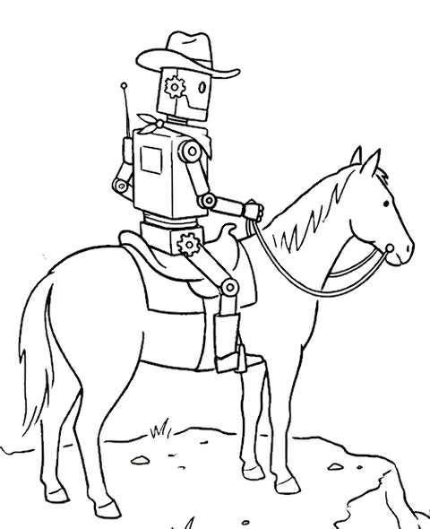

# panio

<picture>
  <source media="(prefers-color-scheme: dark)" srcset="docs/panio-on-horse-dark.png">
  
</picture>

Agent-controlled target machine wrangler for low-level software development.

The name reads as "Pan I/O". For bootloader, firmware, and OS bring-up
work, it lets an AI agent netboot the target, watch its output, send it input,
and power-cycle it, with no human in the loop.

<br clear="left">

## See it work

An agent on a laptop drives an Intel NUC's firmware setup in another room: it
exits setup, catches `F2` during POST through the KVM's emulated keyboard,
confirms by OCR that it is back in setup, then clicks with an absolute mouse:


```console
$ panio hid send -t lab-nuc-1 key ENTER          # discard & exit → the NUC reboots
$ for i in $(seq 30); do panio hid send -t lab-nuc-1 key F2 >/dev/null; done
$ until panio video read lab-nuc-1 | grep -q -i "bios version"; do sleep 2; done
$ panio hid send -t lab-nuc-1 moveabs 19583 5871 ; panio hid send -t lab-nuc-1 click left
```

More on the [demos page](https://panio.dev/demos/).

---

## Capabilities

| Subsystem | Commands | What it does |
|---|---|---|
| [Netboot](https://panio.dev/netboot/) | `panio netboot` | DHCP + TFTP + HTTP netboot over a direct USB-Ethernet link (Raspberry Pi; UEFI PXE / HTTP Boot) |
| [Remote labs](https://panio.dev/distributed-control/) | `panio --lab …` | Drive targets on remote control hosts over SSH from one git-tracked lab file |
| [Target leases](https://panio.dev/leases/) | `panio lease` | Reserve a whole target for one holder (shared lab, parallel agents): others can read but not change it; leases expire on their own and clean the target up |
| [Control hosts](https://panio.dev/control-host/) | `panio skill control-host` | Blank Raspberry Pi to agent-reachable control host in one human action (stock Pi OS plus a cloud-init seed) |
| [Link mode](https://panio.dev/netif/) | `panio netif` | Switch the link between netboot, ffx-over-IPv6, `link`, and `off` modes; `down-hard` adds WoL off + admin-down (many USB adapters keep link anyway) |
| [Video](https://panio.dev/video/) | `panio video` | HDMI capture daemon (or a network RFB source such as a JetKVM); on-device OCR |
| [Serial](https://panio.dev/serial/) | `panio serial` | Serial console: interactive (tio), timestamped line log, read-only health, immutable receive evidence, bounded fresh wait/follow, locked request/response transactions |
| [Power control](https://panio.dev/power/) | `panio power on/off`, `panio power-cycle`, `panio power-state`, `panio serial dtr/reset` | DTR power button (J2 header) and shell-command hooks, with optional named levels (`--level hard`) for targets with several power layers; helpers `cambrionix` (hub ports), `dsdrelay` (USB serial relay boards), `zigplug` (Zigbee plugs), `shellyplug` (Shelly Gen2+), `amt` (Intel AMT/vPro, verified HTTPS by default), `dsdble` (Bluetooth LE relay boards; wireless fallback, no state read-back), `phidget` (Phidgets VINT relay modules over USB, no state read-back) |
| [Named actions](https://panio.dev/actions/) | `panio action` | Per-target named controls that are not power (reset, recovery, boot straps), each a hook command, discoverable by agents |
| [HID injection](https://panio.dev/hid/) | `panio hid` | USB keyboard/mouse injection via a helper (`hidrig` KB2040 injector, `ch9329` for Openterface Mini-KVM / KVM-Go and Sipeed NanoKVM-USB, or `jetkvm` for the JetKVM network KVM) |
| [Switchable USB media](https://panio.dev/usb/) | `panio usb` | Switch a KVM-Go's microSD card between control host and target, as boot media |
| [adb (Android targets)](https://panio.dev/adb/) | `panio adb` | Drive an Android DUT over one USB cable: console (`shell`/`run`), screen (`screencap`), input |
| [Dashboard](https://panio.dev/dashboard/) | `panio console` | Video (noVNC, type and click in the page) + serial web UI; auto-starts daemons; `-i <name>` preselects a serial interface |
| [MCP server](https://panio.dev/mcp/) (experimental) | `panio mcp` | Runtime commands as MCP tools over stdio for agent harnesses; screenshots come back as images |
| Agent skills | `panio skill` | List the bundled agent guides, or print one's `SKILL.md` |
| Lab config & diagnostics | `panio target`/`host`/`config`, `panio discover`, `panio configure`, `panio doctor`, `panio daemons` | Manage the lab file, discover hardware, check config against reality, list and restart daemons |
| [Exit status and errors](https://panio.dev/errors/) | `panio --json-errors …` | Exit codes name the failure kind; `--json-errors` adds a one-line JSON object |

A **target** (DUT, device under test) is the machine being developed on; a
**control host** is the machine cabled to it.

For Openterface devices using USB virtual serial ports on Linux, see the
[startup compatibility warning and workaround](https://panio.dev/hid/#openterface-cdc-on-linux).

For RAM delivery through an existing USB fastboot client, see the
[guarded staging workflow](https://panio.dev/fastboot/).
It defines an external runner's ownership, readiness and verification contract;
panio does not bundle a fastboot channel.

---

## Installation

### Homebrew (macOS and Linux)

The tap pours prebuilt binaries: universal on macOS (Apple Silicon and Intel),
and x86-64 or arm64 on Linux. No Rust toolchain needed:

```bash
brew tap curtisgalloway/tap
brew install panio
```

Upgrade with `brew upgrade`. Run `panio setup` once after installing: on
macOS it setuid-installs `netbootd-bpf-helper` (one sudo); on Linux it checks
`dialout`/`video` group membership. Both install the optional zigplug helper.

On a Linux host that runs capture daemons for days at a time (a control host),
prefer the apt repository below. The `.deb` also installs a `tmpfiles.d` rule
that keeps systemd from deleting the daemons' discovery files after ten days
([#187](https://github.com/curtisgalloway/panio/issues/187)); Homebrew cannot
install files outside its prefix.

`brew install --HEAD panio` builds `main` from source, the same path as
`make install` below.

### Linux: apt repository

On Debian 12+ / Raspberry Pi OS (amd64/arm64), use the signed apt repository;
upgrade with `apt upgrade`:

```bash
sudo install -d /etc/apt/keyrings
sudo curl -fsSL -o /etc/apt/keyrings/panio.asc https://panio.dev/apt/panio.asc
sudo tee /etc/apt/sources.list.d/panio.sources >/dev/null <<'EOF'
Types: deb
URIs: https://panio.dev/apt
Suites: stable
Components: main
Signed-By: /etc/apt/keyrings/panio.asc
EOF
sudo apt update && sudo apt install panio
```

### A new Raspberry Pi control host

For a blank Pi, skip the steps above: flash stock Raspberry Pi OS, drop four
seed files on its boot partition, and power on. It comes up with SSH
authorized and the release `.deb` installed. See
[standing up a control host](https://panio.dev/control-host/);
the exact commands, including how to pick the right SD card, are in
`panio skill control-host`.

### Release packages

Each [GitHub Release](https://github.com/curtisgalloway/panio/releases) has
a `.deb` and a tarball: `sudo apt install ./panio_<version>_<arch>.deb`.

After the apt repository or a release package, run `panio setup` once: it
sets group membership and installs the optional zigplug helper.

### From source

Requirements:

- macOS 10.14 (Mojave) or later, or Linux (x86-64 / arm64)
- On macOS: [Homebrew](https://brew.sh)
- Rust toolchain (`brew install rustup` on macOS, or `rustup.rs` on Linux)
- On Linux: `sudo apt-get install pkg-config libudev-dev libclang-dev cmake nasm`
  (`make install` checks for these and tells you what's missing)

```bash
git clone https://github.com/curtisgalloway/panio ~/src/panio
cd ~/src/panio
make install           # panio CLI + daemons + OCR helper, in one step
```

`make install` bootstraps the CLI with `cargo install --path cli`, then runs
`panio setup`, which builds and installs the rest. Where things land:

- **The `panio` CLI** is the only thing on PATH (`~/.cargo/bin`).
- **Daemons and helpers** (`hdmicap`, `serialcap`, `netbootd`, `cambrionix`,
  `dsdrelay`, `dsdble`, `phidget`, `hidrig`, `ch9329`, `shellyplug`, `amt`) and **the OCR helper** (`visionocr`
  on macOS via `swiftc`, `linuxocr` on Linux) go in
  `~/.local/libexec/panio/bin`, off PATH. Run one with
  `panio helper <name> [args…]` (no name lists them; `-t <target>
  --channel <kind>` or `--host <labhost>` before the name runs it on that
  host). Everything after the name goes to the helper, so
  `panio helper serialcap --help` shows the helper's own help.
- **Bundled agent skills** go in `~/.local/share/panio/skills` (the
  `.deb`/tarball ship them under `/usr/share/panio/skills`).
  `panio skill [NAME]` lists or prints them.
- **Out-of-tree helpers and skills** can stay in their own checkout: list its
  prefix in `PANIO_PLUGIN_PATH` (a lab host's `plugin_path` for a control
  host). Plugins add helpers and skills but never shadow bundled ones; see
  [plugin roots](https://panio.dev/power/#out-of-tree-helpers-and-skills-plugin-roots).
- **On macOS**, `setup` also installs `netbootd-bpf-helper` setuid-root (one
  sudo) for `netbootd`.
- **Configuration** is one CLI-managed lab file
  (`~/.config/panio/lab.toml`); see
  [notes/config-redesign.md](notes/config-redesign.md).

The only Python component is the optional `zigplug` helper, which `setup`
installs as a uv tool. After pulling or editing, re-run:

```bash
make install           # rebuilds and reinstalls everything (idempotent)
```

`make rust` rebuilds only the Rust crates (no OCR/setuid/zigplug steps);
`make help` lists every target. To install one component directly, helpers
need `--root` so they land in libexec:

```bash
cargo install --path ~/src/panio/cli        # if the CLI changed
cargo install --path ~/src/panio/hdmicap   --root ~/.local/libexec/panio  # if hdmicap changed
cargo install --path ~/src/panio/serialcap --root ~/.local/libexec/panio  # if serialcap changed
cargo install --path ~/src/panio/netbootd  --root ~/.local/libexec/panio  # if netbootd changed (re-run `panio setup` to re-setuid the helper on macOS)
cargo install --path ~/src/panio/cambrionix --root ~/.local/libexec/panio # if cambrionix changed
cargo install --path ~/src/panio/dsdrelay  --root ~/.local/libexec/panio  # if dsdrelay changed
cargo install --path ~/src/panio/dsdble    --root ~/.local/libexec/panio  # if dsdble changed (Linux build needs libdbus-1-dev)
cargo install --path ~/src/panio/phidget   --root ~/.local/libexec/panio  # if phidget changed
cargo install --path ~/src/panio/hidrig    --root ~/.local/libexec/panio  # if hidrig changed
cargo install --path ~/src/panio/ch9329    --root ~/.local/libexec/panio  # if ch9329 changed
cargo install --path ~/src/panio/shellyplug --root ~/.local/libexec/panio # if shellyplug changed
cargo install --path ~/src/panio/amt       --root ~/.local/libexec/panio  # if amt changed
UV_TOOL_BIN_DIR=~/.local/libexec/panio/bin uv tool install --force ~/src/panio/zigplug # if zigplug changed
```

---

## Remote control pattern

An agent or script on a dev machine SSHes into the control host:

```bash
# Configure target once
ssh control-mac "panio target add target-machine"
ssh control-mac "panio netboot set -t target-machine --interface en3 --tftp-root ~/pxe"
ssh control-mac "panio power set -t target-machine --cycle-cmd /path/to/power-cycle.sh"

# Deploy a new kernel and boot
TFTP_ROOT=$(ssh control-mac "panio netboot tftp-root target-machine")
scp out/kernel.img control-mac:"${TFTP_ROOT}/kernel_2712.img"
ssh control-mac "panio netboot start target-machine"
ssh control-mac "panio netboot logs -f target-machine"

# Interact with the console
ssh control-mac "panio serial log -t target-machine -i console --tail 50"

# Power cycle and repeat
ssh control-mac "panio power-cycle target-machine"
```

---

## Documentation

Full documentation:
**[panio.dev](https://panio.dev/)**
(source in [`docs/`](docs/README.md)).

- **User guides:** linked in the [capabilities table](#capabilities).
- **[Recommended hardware](https://panio.dev/recommended-hardware/):** what to
  buy to get started.
- **[Demos](https://panio.dev/demos/)** and
  **[tested hardware](https://panio.dev/hardware/)**.
- **[Glossary](https://panio.dev/glossary/):** the
  hardware, protocol and panio terms these docs use.
- **Developer docs:** start with the
  [**architecture overview**](https://panio.dev/dev/architecture/),
  then the [requirements tracker](https://panio.dev/dev/requirements/).
  Source in [`docs/dev/`](docs/dev).

[`notes/`](notes/README.md) holds point-in-time design records and bring-up
findings. They are not kept current and not published.

---

## License

Apache 2.0 — see [LICENSE](LICENSE).

Terminology is defined in the [glossary](docs/glossary.md). Serial capture also exposes
read-only [health snapshots](docs/serial.md#read-only-health) via CLI and MCP.
